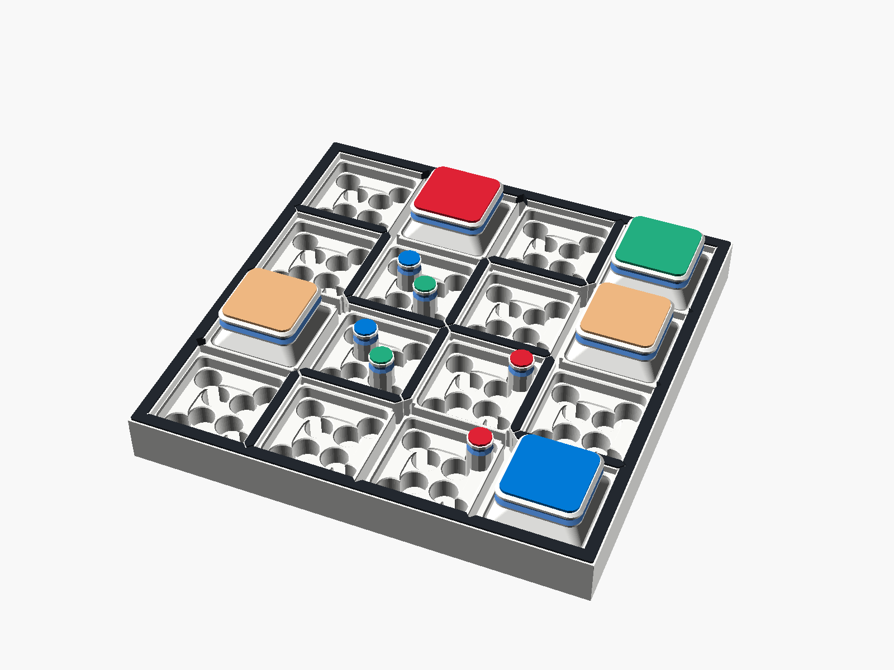
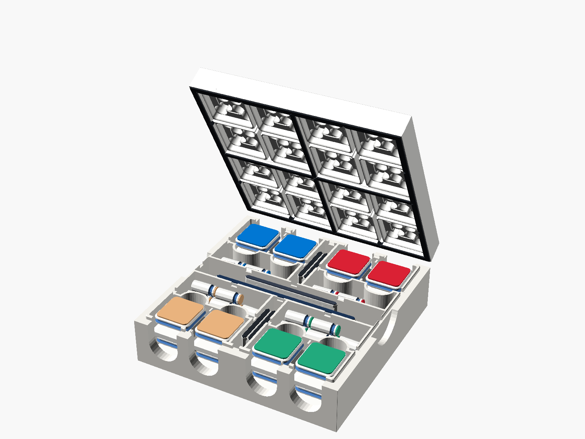
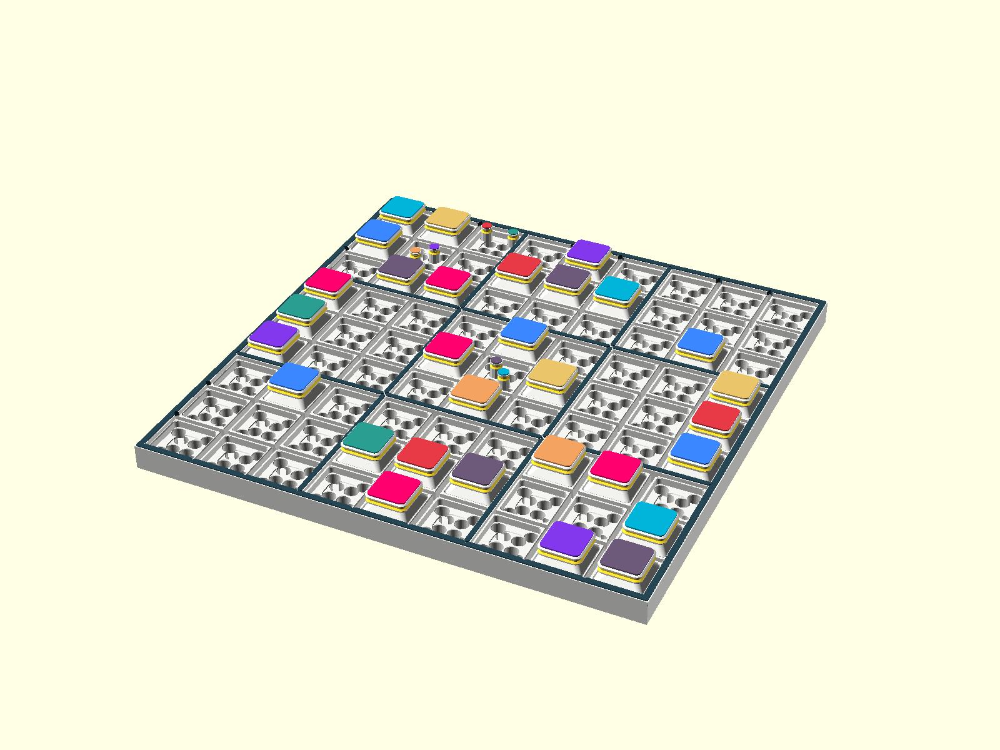
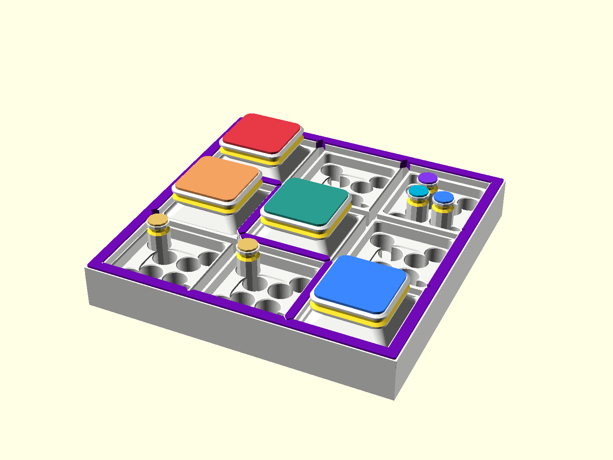

# Modular Color Sudoku System — Montessori Jigsaw 1×1 Edition

> **License — Personal Use Only (No Commercial Use):** All 3D models (STLs, 3MFs, OpenSCAD source), puzzle workbooks, and assets in this repository are licensed under [CC BY-NC-SA 4.0](LICENSE). You are welcome to download, print, and enjoy these for **personal, non-commercial use** at home. **Commercial use—including 3D-printing, manufacturing, reproducing, or selling physical sets, parts, or workbooks—is strictly prohibited.**




Parametric 3D-printable modular Color Sudoku board (~35 mm cell pitch, `145.6 × 145.6 mm` for the one-piece 4×4 kids' board, ~`320.6 × 320.6 mm` for a full 9×9) designed for **Bambu Studio / Bambu Lab A1 Mini** in White PLA / PLA Matte.

## 4×4 Kids' Sudoku & Workbook Highlights (`kids_4x4/`)

The 4×4 render above introduces the core puzzle ideas from the printable [4×4 Kids' Sudoku Workbook](kids_4x4/README.md) on the one-piece board (`stl/boards/board_4x4.stl`) paired with the flush board-as-lid carry tray (`stl/holders/piece_holder.stl`):

- **Jigsaw Regions (Level 7):** 12 short `1x` region bars drop into the interior grid slots to form four T-shaped regions framed by the board's permanent raised border.
- **Center-Mark Naked Pair (Levels 3 & 6):** In Column 2, the two middle cells (`R2C2` and `R3C2`) each hold a **Blue + Green** center-peg pair — locking Blue and Green into those two cells and eliminating Green from `R4C2` (leaving **Tan**).
- **Snyder Notation Pointing Pair (Levels 4 & 5):** In the bottom-right Jigsaw region, **Red** can only go in `R3C3` or `R4C3` (shown with top-right corner pegs). Because both sit in Column 3, they point straight up the column to eliminate Red from `R2C3` (leaving **Blue**).
- **Flush Board-as-Lid Carry Case (Option B):** Flip the 4×4 board upside down to close the four-quadrant tray flush (`145.6 × 145.6 mm`), keeping all 16 main pieces, 64 pencil-mark pegs, and `1x`/`2x`/`3x` region bars organized inside.

## Full 9×9 Modular Board & Close-Up Detail




## Montessori Jigsaw Connection (Easy Kid Assembly + Holds Flat When Lifted)

- **Outward Male Nubbins on Bottom & Right, Inward Female Sockets on Top & Left:**
  - Each Male tab has a **1.5 mm center flex slot** + a **gentle mid-height Z-detent ridge** (`Z = 2.5 mm`) with generous `0.25 mm` XY clearance so kids can easily click tiles together and pull them apart without wedging.
  - Each Female socket has a **45° self-centering vaulted ceiling** and a **2.55 mm solid roof** underneath the cell floor (`Z = 6.45` to `9.0 mm`). When you pick the board up from the bottom, the vaulted roof + Z-detent + `9.0 mm` base hold the board flat without tiles dropping through.
- **Raised Flat Paint Surfaces:** `main_piece`, `pencil_peg`, and `region_bar_*` have raised flat top pads proud above the white body so you can paint the top surface cleanly with paint markers.

## STL Files (`stl/`)

- **One-Piece 4×4 Board (`stl/boards/board_4x4.stl`) & Carry Case (`stl/holders/piece_holder.stl`)**:
  - Single-print monolithic 4×4 board (`145.6 × 145.6 × 13.5 mm` deck, `16.75 mm` including raised border — prints in one piece on a Bambu Lab A1 Mini `180 × 180 mm` bed).
  - Features a solid raised perimeter barrier wall (`2.85 mm` solid outer wall behind each interior slot end) so interior `region_bar_2x` and `region_bar_1x` (Jigsaw) dividers drop right in and can never slide out, with all 4 outer sides completely smooth and flush for a tray.
  - Matching Option B four-quadrant carry tray (`stl/holders/piece_holder.stl`) that uses the upside-down 4×4 board as a flush lid and stores all 16 main pieces, 64 pencil-mark pegs, and `1x`/`2x`/`3x` region bars.
- **Modular 1×1 Board Tiles (`stl/boards/`) — Flush Outer Perimeter & Captured Interior Slots** (for an $M \times N$ grid; 9×9 / 4×4 counts shown):
  - `boards/tile_center.stl` — Interior tile with Bottom + Right region slots & tabs, Top + Left sockets (`(M-2)×(N-2)` = **49×** for 9×9, **4×** for 4×4)
  - `boards/tile_edge_n.stl` — Top edge with flush solid North barrier wall (`M-2` = **7×** for 9×9, **2×** for 4×4)
  - `boards/tile_edge_s.stl` — Bottom edge with flush solid South barrier wall (`M-2` = **7×** for 9×9, **2×** for 4×4)
  - `boards/tile_edge_w.stl` — Left edge with flush solid West barrier wall (`N-2` = **7×** for 9×9, **2×** for 4×4)
  - `boards/tile_edge_e.stl` — Right edge with flush solid East barrier wall (`N-2` = **7×** for 9×9, **2×** for 4×4)
  - `boards/tile_corner_nw.stl` — Top-Left corner with flush solid North + West barrier walls (**1×**)
  - `boards/tile_corner_ne.stl` — Top-Right corner with flush solid North + East barrier walls (**1×**)
  - `boards/tile_corner_sw.stl` — Bottom-Left corner with flush solid South + West barrier walls (**1×**)
  - `boards/tile_corner_se.stl` — Bottom-Right corner with flush solid South + East barrier walls (**1×**)
  - *Note:* All 4 outer board faces are completely flush (`M × 35 + 5.6 mm`, i.e., `145.6 × 145.6 mm` for 4×4 or `320.6 × 320.6 mm` for 9×9) with no protruding tabs or open sockets on the outside, and the solid outer barrier wall stops every interior region slot so interior divider bars cannot slide out.
- **Game Pieces (`stl/pieces/`), Pegs (`stl/pegs/`), Dividers (`stl/borders/`), & Print Plates (`stl/plates/`)**:
  - `pieces/main_piece.stl` (plus `main_piece_1..9.stl`, `main_piece_A..I.stl`, and `main_piece_shape_*.stl`) — Full-cell solved tile with raised flat paint pad
  - `pegs/pencil_peg.stl` (plus `pencil_peg_1..9.stl` and `pencil_peg_A..I.stl`) — Non-rolling octagonal candidate peg with raised flat paint cap
  - `borders/region_bar_1x.stl` — 1-cell mitered box divider with raised flat paint ridge
  - `borders/region_bar_2x.stl` — 2-cell mitered box divider
  - `borders/region_bar_3x.stl` — 3-cell mitered box divider
  - `plates/*.3mf` — Pre-arranged Bambu Studio print plates (`16pieces64pencilmarks.3mf`, `board_holder_plusplus.3mf`, `region_bar_2x.3mf`, `region_bar_3x.3mf`)

## Re-rendering STLs & Previews

```bash
make all
make renders
```

## License

Copyright © 2026 DoDad Puzzles LLC (DoDad Puzzles™ — [dodadpuzzles.com](https://dodadpuzzles.com)).

This project—including all OpenSCAD source files, STL/3MF 3D models, puzzle generators, and printable PDF workbooks—is licensed under the **Creative Commons Attribution-NonCommercial-ShareAlike 4.0 International License ([CC BY-NC-SA 4.0](LICENSE))**.

- **Allowed:** Downloading, 3D-printing, sharing, and adapting these files for **personal, non-commercial use** (e.g., making a set for your own family or classroom) with attribution.
- **Not Allowed:** Any **commercial use** without explicit written permission—you may **not** 3D-print and sell physical boards, pieces, or workbooks, nor sell or redistribute the digital files commercially.

