# Build Your 4x4 Kids' Sudoku Board (Flush-Edge Edition)

LEGO-style, one step at a time. **Orange** parts are new in each step, white/dark parts are already
in place, and the teal arrows show where things drop in.

> All parts come from the main board design in [`../src/color_sudoku_board.scad`](../../src/color_sudoku_board.scad).
> To re-draw these pictures, run `make instructions` in the `kids_4x4/` folder.

---

## Step 0: Gather your parts

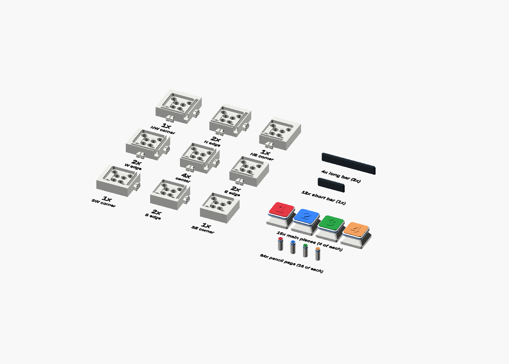

> **One-Piece Print Option:** If you only need a 4×4 board and don't want to snap 16 individual tiles
> together, print **`../stl/board_4x4.stl` (1×)** (`145.6 × 145.6 × 12.5 mm`, fits in one piece on a
> Bambu Lab A1 Mini) and skip straight to **Step 7**! All interior slots accept both the `2x` box
> bars and the `1x` Jigsaw bars.

All 4 outside edges of the board have **built-in solid raised barrier walls** and **flush outer faces**
(`145.6 × 145.6 mm` total footprint, with no protruding tabs or open sockets on the outside) so the
finished board sits flush inside a carrying tray and interior region bars can never slide out!

| Qty | Part | STL file (`../stl/`) | Where it goes on a 4×4 board |
|---:|---|---|---|
| 1 | Top-Left (NW) corner tile | `tile_corner_nw.stl` | Row 1, Column 1 (flush N & W walls; S & E tabs) |
| 2 | Top (N) edge tile | `tile_edge_n.stl` | Row 1, Columns 2–3 (flush N wall; W socket; S & E tabs) |
| 1 | Top-Right (NE) corner tile | `tile_corner_ne.stl` | Row 1, Column 4 (flush N & E walls; W socket; S tab) |
| 2 | Left (W) edge tile | `tile_edge_w.stl` | Rows 2–3, Column 1 (flush W wall; N socket; S & E tabs) |
| 4 | Center tile | `tile_center.stl` | Rows 2–3, Columns 2–3 (N & W sockets; S & E tabs) |
| 2 | Right (E) edge tile | `tile_edge_e.stl` | Rows 2–3, Column 4 (flush E wall; N & W sockets; S tab) |
| 1 | Bottom-Left (SW) corner tile | `tile_corner_sw.stl` | Row 4, Column 1 (flush S & W walls; N socket; E tab) |
| 2 | Bottom (S) edge tile | `tile_edge_s.stl` | Row 4, Columns 2–3 (flush S wall; N & W sockets; E tab) |
| 1 | Bottom-Right (SE) corner tile | `tile_corner_se.stl` | Row 4, Column 4 (flush S & E walls; N & W sockets) |
| 4 | Long bar (2x) | `region_bar_2x.stl` | Inside 2×2 box walls (2 across, 2 up-and-down) |
| 12 | Short bar (1x) | `region_bar_1x.stl` | Wobbly jigsaw walls (Level 9) |
| 16 | Main pieces | `main_piece_1..4.stl` (4 of each) | The big "answer" pieces |
| 64 | Pencil pegs | `pencil_peg_1..4.stl` (16 of each) | Center marks and corner marks |

**Tip:** Paint (or print) each number its own color: 1 = red, 2 = blue, 3 = green, 4 = orange.
Do the same for the pegs. Then the same pieces work for the **Coloring** level (Level 8).

---

## How the tiles click together

Interior tile edges have **bumps** (male nubbins) pointing **down (South)** and **right (East)**, and
**sockets** (female pockets) on the **top (North)** and **left (West)** that are open underneath.
A new tile always drops **straight down** over the bumps of the tiles above it and to its left.
Outside edges are completely flat and smooth!

---

## Step 1: The top-left corner

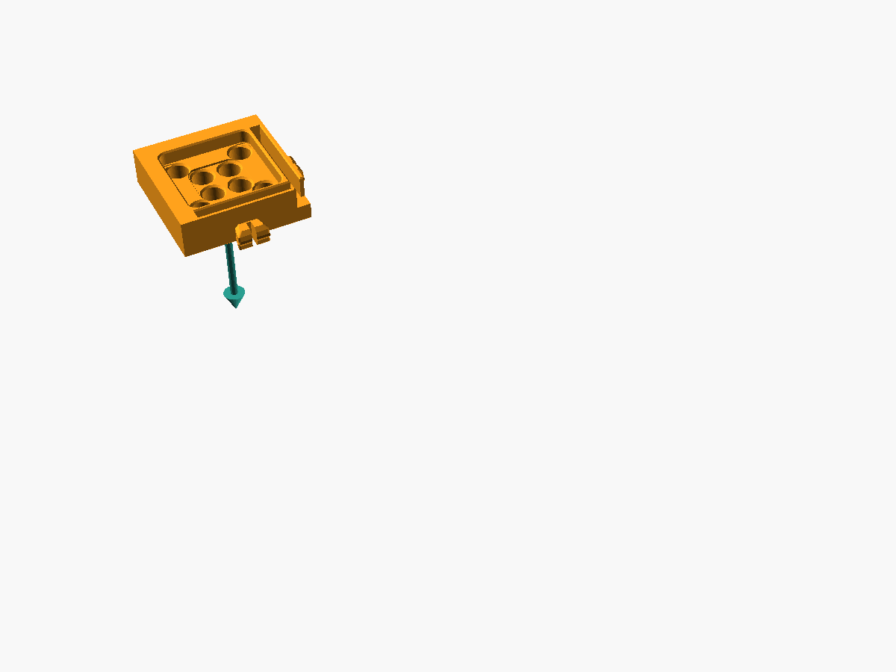

Place the **Top-Left corner tile** (`tile_corner_nw`) flat on the table. Its two smooth, flat outer
walls face **away from you (North)** and **to the left (West)**, and its two bumps point **toward
you** and **to the right**.

## Step 2: Finish the top row

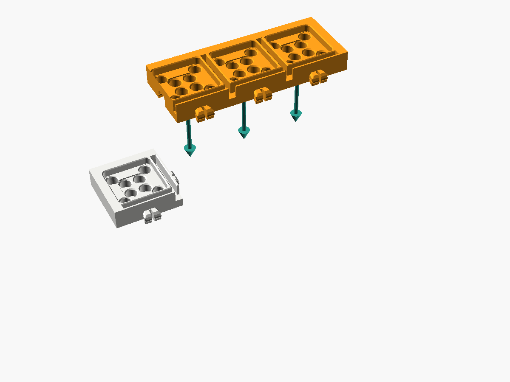

Working left to right across the top row, press down **2 Top-edge tiles** (`tile_edge_n`) and then
the **Top-Right corner tile** (`tile_corner_ne`) on the far right. *Click!* Notice how the top and
right outside edges are already smooth and flush.

## Step 3: Finish the left column

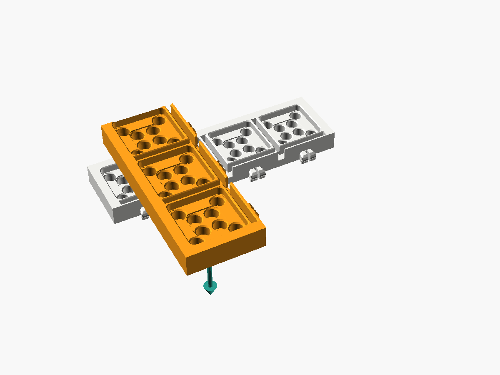

Working top to bottom down the left side, press down **2 Left-edge tiles** (`tile_edge_w`) and then
the **Bottom-Left corner tile** (`tile_corner_sw`) at the bottom-left corner.

## Step 4: Row 2

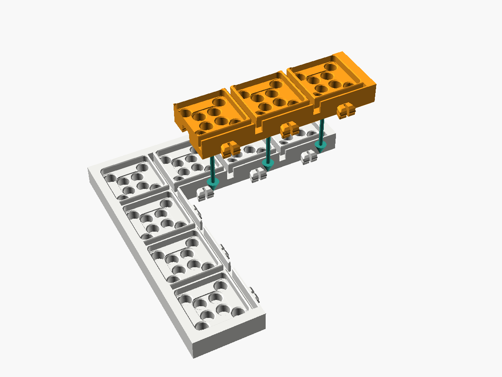

Fill Row 2 from left to right: press down **2 Center tiles** (`tile_center`), and finish the row on
the right with **1 Right-edge tile** (`tile_edge_e`). Each tile clicks onto the bumps above it and
to its left at the same time.

## Step 5: Row 3

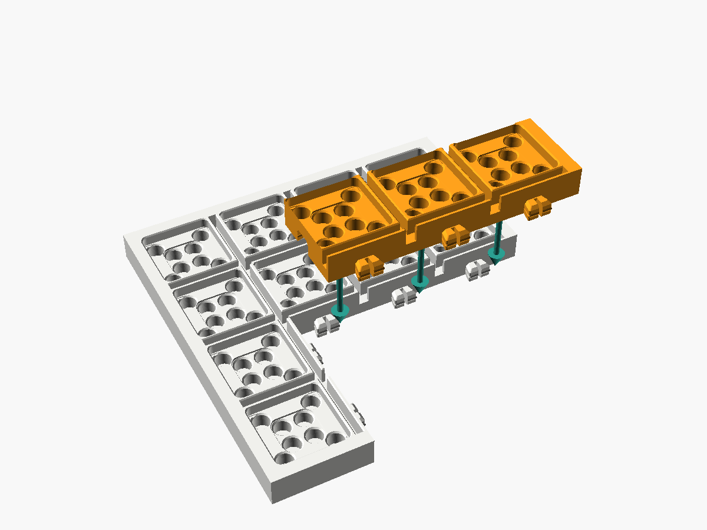

Repeat for Row 3 from left to right: **2 Center tiles** (`tile_center`) followed by **1 Right-edge
tile** (`tile_edge_e`).

## Step 6: Row 4 (bottom row)

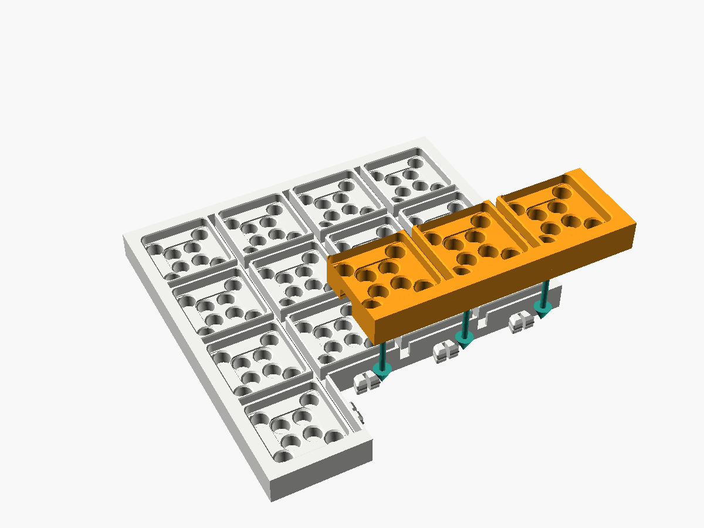

Finish the bottom row from left to right: press down **2 Bottom-edge tiles** (`tile_edge_s`) and
cap the corner with the **Bottom-Right corner tile** (`tile_corner_se`). You now have a rigid 16-square
board with a solid raised outer wall and all 4 outside edges completely flush!

## Step 7: Make the 4 boxes

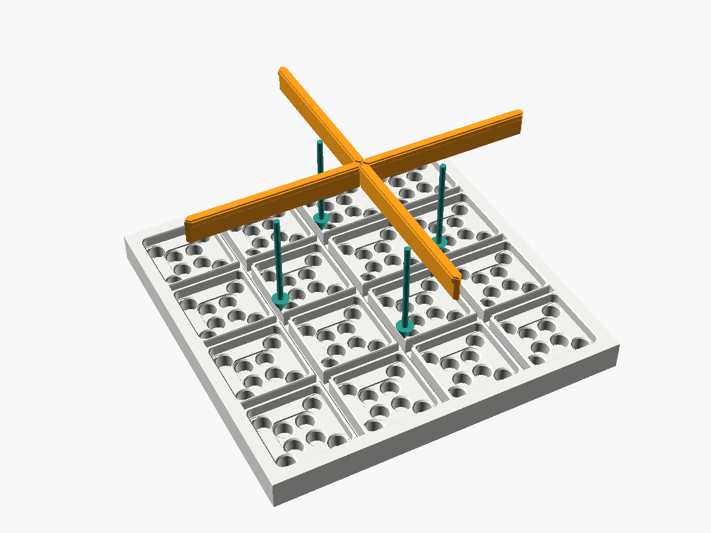

Slide **4 long bars** (`region_bar_2x`) into the deep cross slots running **through the middle** of
the board: 2 going across and 2 going up and down. Because the outer board wall is solid, the bars
are trapped at the ends and can never slide out!

## Step 8: Set up a puzzle

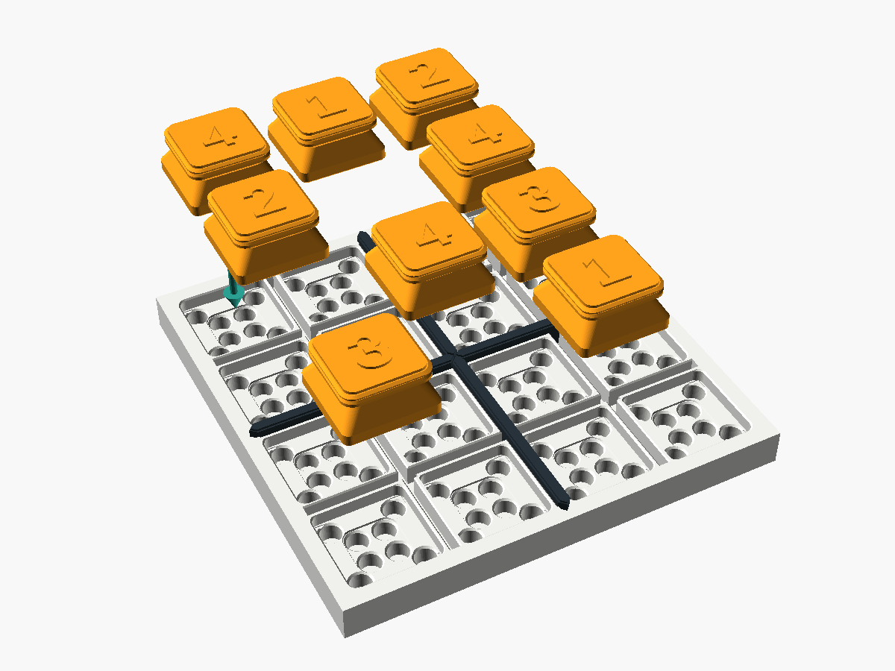

Pick a puzzle from the workbook (this one is **Puzzle 1.01**). Put a **main piece** in each square
that shows a number. Press it down until it sits snugly between the cell walls.

## Step 9: Pencil pegs

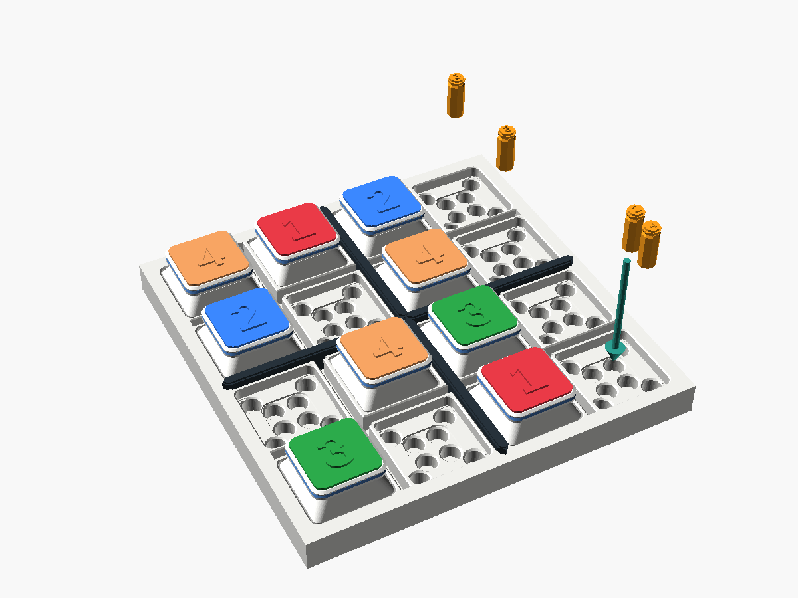

Every square has **4 center holes** and **4 corner holes**. Each number always uses the same spot:

```
  1 . 2        corner holes: same idea, out in the corners
  3 . 4
```

* **Center marks** (Level 3): in the bottom-right square, the **2** and **4** pegs say "this square is a 2 or a 4."
* **Corner marks / Snyder notation** (Level 4): the two **3** pegs in the bottom-left corner holes say
  "in this box, the 3 is in one of these two squares."

If a workbook puzzle prints small numbers inside **circles**, use center pegs. If they're inside
**squares** out in the corners, use corner pegs.

## Step 10 (Level 9 bonus): Wobbly jigsaw rooms

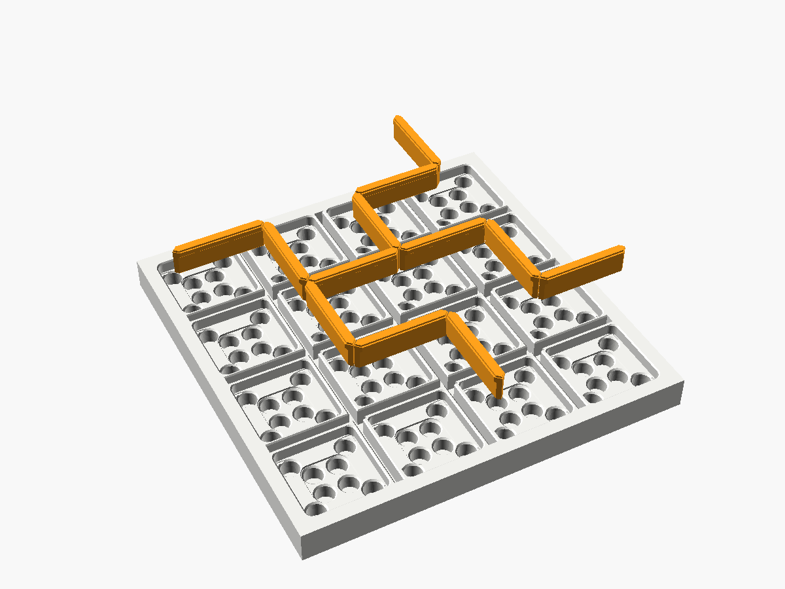

Pull out the 4 middle long bars. Use **short bars** (`region_bar_1x`) in the interior slots to
build the funny shapes printed on the Jigsaw puzzle. Every thick line inside the printed grid
is one short bar, and the solid outer border wall automatically frames the outside of every room.

---

## Taking it apart

Lift tiles **straight up** in the reverse order: bottom-right (`tile_corner_se`) first, ending with
the top-left corner (`tile_corner_nw`). The interior bars and pegs pull straight up and out.
